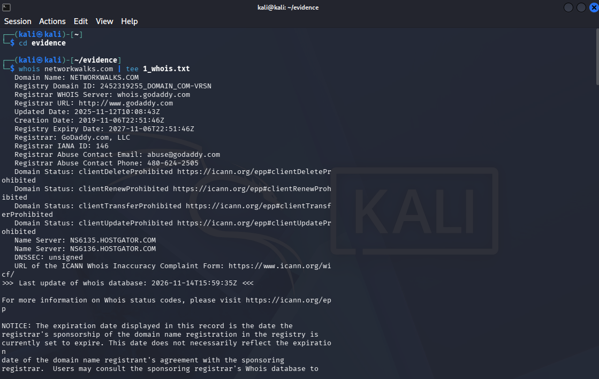
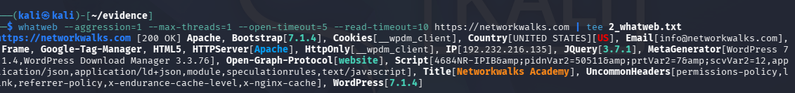
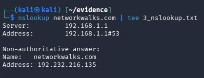
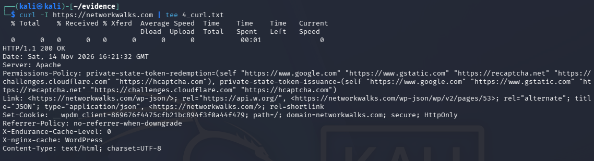
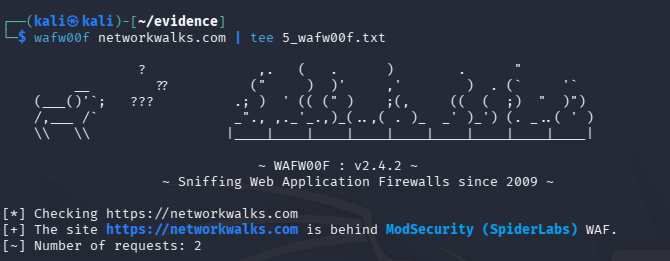
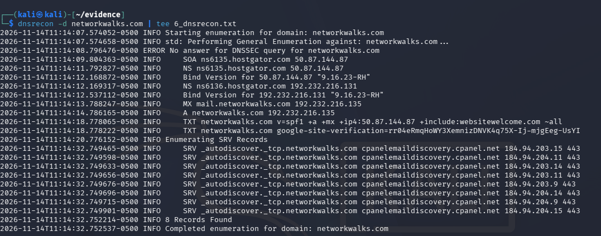
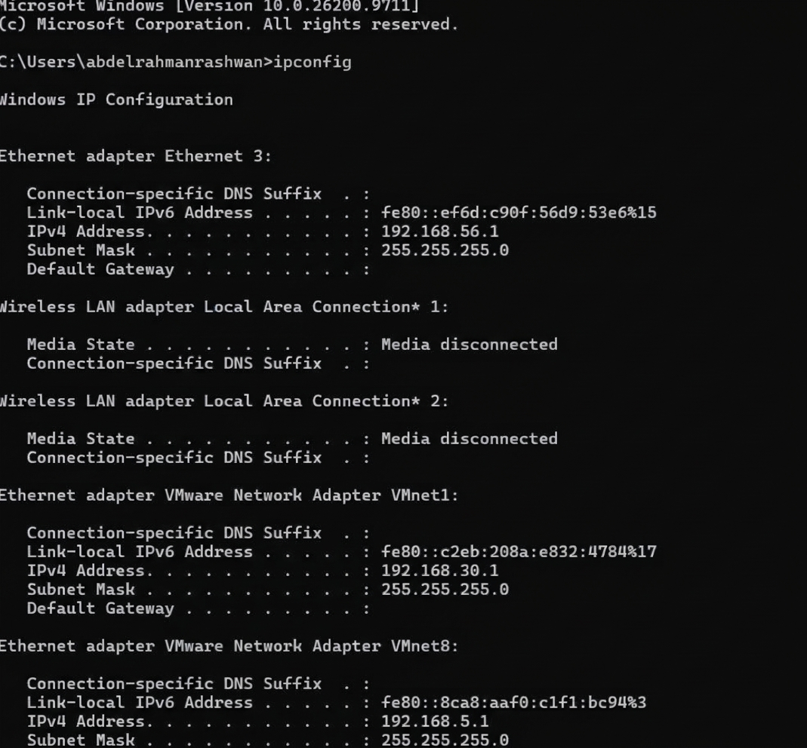
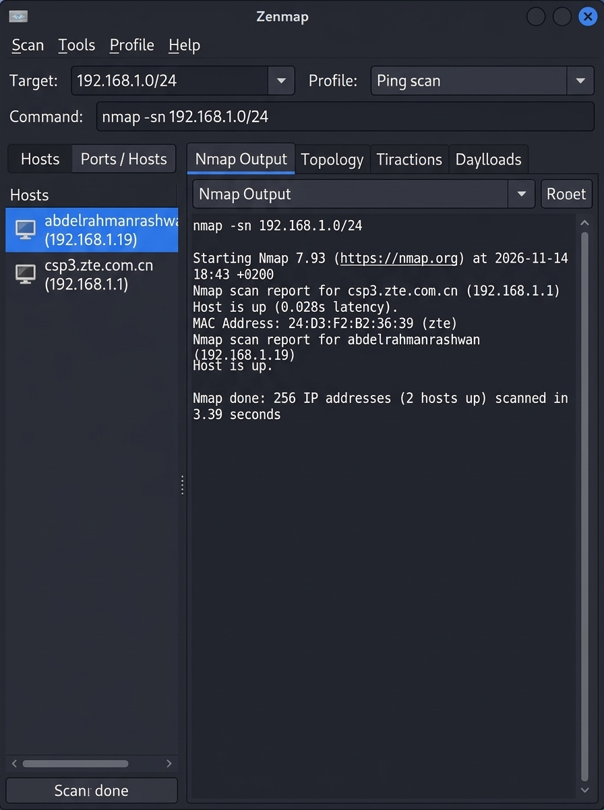

# Week 2: Footprinting & Network Scanning
Networkwalks Cybersecurity Internship, Batch B084

**Student Name:** Abdelrahman Rashwan  
**Target Domain:** `networkwalks.com`  
**Local Network Subnet:** `192.168.1.0/24`  

---

## 📄 Final Penetration Testing Report
* 👉 **[Download Week 2 Final Report (PDF)](./W2-PM-FINAL_Penetration_Testing_Report_Abdelrahman_Rashwan.pdf)**

---

## 🔍 Module W2-PM1: Footprinting with Multiple Kali Tools

### 1. WHOIS Lookup (`whois`)

### 2. Web Technology Fingerprinting (`whatweb`)

### 3. DNS Resolution (`nslookup`)

### 4. HTTP Header Inspection (`curl`)

### 5. Web Application Firewall Detection (`wafw00f`)

### 6. DNS Enumeration (`dnsrecon`)

---

## 🌐 Module W2-PM5: Network Scanning with Zenmap

### 1. Host IP Configuration (`ipconfig`)

### 2. Zenmap Scan Output

### 3. Network Topology Map

